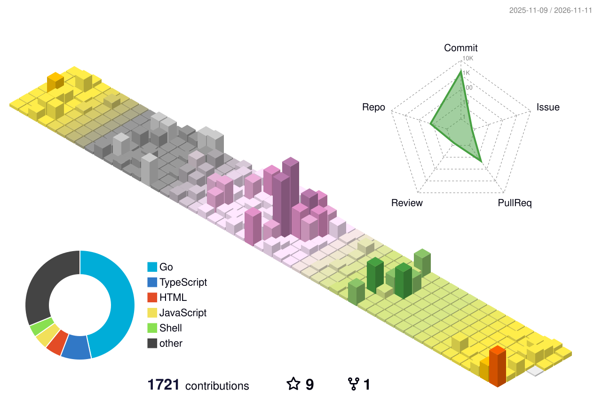

<h1 align="center"></h1>

<!-- 贪吃蛇代码贡献图 -->
<div align="center">
    
</div>


<br />

#  🙋 Hello

hi, i'm caochenxu, after 90 years, living in Beijing, China; engaged in back-end development. 

  

<br />

**languages and tools:**

<code></code>
<code></code>
<code></code>
<code></code>
<code></code>
<code></code>
<code></code>
<code></code>
<code></code>
<code></code>

<br />
<br />
<br />
<br />
<br />
<br />
<br />
<br />
<br />

# 🌱 My GitHub Growth
<!-- profile-3d-contrib -->
<div align="center" ></div>

# 🚀 Actions

<!--START_SECTION:waka-->


**🐱 My GitHub Data** 

> 📦 227.0 kB Used in GitHub's Storage 
 > 
> 🏆 1,517 Contributions in the Year 2026
 > 
> 🚫 Not Opted to Hire
 > 
> 📜 24 Public Repositories 
 > 
> 🔑 14 Private Repositories 
 > 
**I'm an Early 🐤** 

```text
🌞 Morning                4528 commits        ████░░░░░░░░░░░░░░░░░░░░░   15.52 % 
🌆 Daytime                14407 commits       ████████████░░░░░░░░░░░░░   49.37 % 
🌃 Evening                10182 commits       █████████░░░░░░░░░░░░░░░░   34.89 % 
🌙 Night                  67 commits          ░░░░░░░░░░░░░░░░░░░░░░░░░   00.23 % 
```
📅 **I'm Most Productive on Monday** 

```text
Monday                   5369 commits        █████░░░░░░░░░░░░░░░░░░░░   18.40 % 
Tuesday                  4066 commits        ███░░░░░░░░░░░░░░░░░░░░░░   13.93 % 
Wednesday                4228 commits        ████░░░░░░░░░░░░░░░░░░░░░   14.49 % 
Thursday                 4287 commits        ████░░░░░░░░░░░░░░░░░░░░░   14.69 % 
Friday                   4156 commits        ████░░░░░░░░░░░░░░░░░░░░░   14.24 % 
Saturday                 2860 commits        ██░░░░░░░░░░░░░░░░░░░░░░░   09.80 % 
Sunday                   4218 commits        ████░░░░░░░░░░░░░░░░░░░░░   14.45 % 
```


📊 **This Week I Spent My Time On** 

```text
🕑︎ Time Zone: Asia/Shanghai

💬 Programming Languages: 
Other                    34 hrs 13 mins      ███████████░░░░░░░░░░░░░░   44.99 % 
Python                   13 hrs 22 mins      ████░░░░░░░░░░░░░░░░░░░░░   17.59 % 
Go                       6 hrs 28 mins       ██░░░░░░░░░░░░░░░░░░░░░░░   08.51 % 
Markdown                 5 hrs 29 mins       ██░░░░░░░░░░░░░░░░░░░░░░░   07.21 % 
Fork                     5 hrs 7 mins        ██░░░░░░░░░░░░░░░░░░░░░░░   06.73 % 

🔥 Editors: 
Codex Vscode             37 hrs 46 mins      ████████████░░░░░░░░░░░░░   49.66 % 
Chrome                   17 hrs 28 mins      ██████░░░░░░░░░░░░░░░░░░░   22.96 % 
Feishu                   10 hrs 13 mins      ███░░░░░░░░░░░░░░░░░░░░░░   13.44 % 
ChatGPT                  9 hrs 13 mins       ███░░░░░░░░░░░░░░░░░░░░░░   12.13 % 
TextMate                 38 mins             ░░░░░░░░░░░░░░░░░░░░░░░░░   00.84 % 

💻 Operating System: 
Mac                      76 hrs 5 mins       █████████████████████████   100.00 % 
```

🤖 **AI Coding This Week** 

```text
⏱ AI Coding Time: 45 hrs 57 mins (60.4%)

✍️ 22,113 lines written by AI, 10 lines written by hand (99.95% AI-written)

🔤 306,854,173 Input Tokens, 28,180,077 Output Tokens

💵 $16384.24 Estimated AI Cost This Week

🧠 182 AI Sessions, 859 AI Prompts

GPT                      21,727 lines        █████████████████████████   98.05 % 
Codex-Vscode             433 lines           ░░░░░░░░░░░░░░░░░░░░░░░░░   01.95 % 

🔎 AI Coding Insights:
🤖 AI-Driven — 99.95% of written lines came from AI
📄 Detailed Prompter — average 687 characters per prompt
🔁 Iterative Prompter — average 5 prompts per session
🚀 High AI Trust — 0.05% of changed lines were hand-edited
```

**I Mostly Code in Go** 

```text
Go                       27 repos            ████████████░░░░░░░░░░░░░   46.55 % 
TypeScript               13 repos            ██████░░░░░░░░░░░░░░░░░░░   22.41 % 
Python                   4 repos             ██░░░░░░░░░░░░░░░░░░░░░░░   06.90 % 
HTML                     3 repos             █░░░░░░░░░░░░░░░░░░░░░░░░   05.17 % 
JavaScript               3 repos             █░░░░░░░░░░░░░░░░░░░░░░░░   05.17 % 
```


 Last Updated on 01/11/2026 05:46:33 UTC
<!--END_SECTION:waka-->
